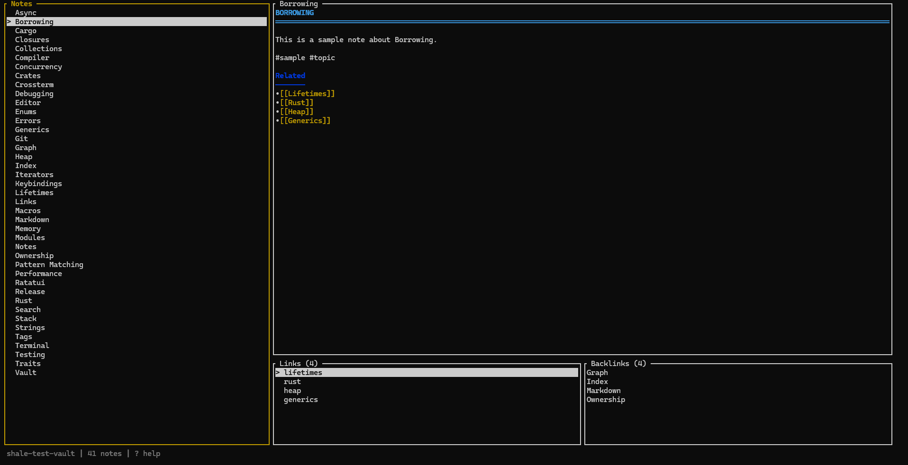

<p align="center">
    
</p>

<h1 align="center">Shale</h1>

<p align="center">
    A terminal notes app for Markdown vaults, written in Rust.<br>
    Wikilinks, backlinks, a link, graphs, tags, tasks and an built-in editor, all from your keyboard.
</p>



Shale reads a folder of `.md` files, the same layout Obsidian uses, so you can point it an existing vault and start browsing. Your notes stay in plain markdown files on disk. There is no database and no lock-in.

## Contents

- [Feature](#features)
- [Install](#install)
- [Usage](#usage)
- [Keybindings](#keybindings)
- [Configuration](#how-it-works)
- [Limitations](#limitations)
- [Project layout](#project-layout)
- [Contributing](#contributing)
- [License](#license)

## Features

- Wikilinks with backlinks, and `(missing)` links you can create with Enter
- Back and forward history
- Graph view of a note and its neighbours
- Quick switcher, full-text search and a tag browser
- Built-in editor with `[[` link autocomplete
- Task list with checkboxes you can toggle
- Rename (updates links), delete to `.trash`, daily notes
- Live reload when files change on disk


## Install

Download the latest build for your OS from the [latest release](https://github.com/LowPolyPhosphorus/shale/releases/latest):

| System | File |
| --- | --- |
| Windows | `shale-windows.exe` |
| Linux | `shale-linux` |
| macOS (Apple Silicon) | `shale-macos` |

Run it through terminal, not double clicking:

```
.\shale-windows.exe --set-vault "C:\path\to\your\vault"
.\shale-windows.exe
```

On macOS and Linux mark the file as runnable first:

```
chmod +x shale-linux
./shale-linux --set-vault ~/path/to/your/vault
```

If you have Rust installed, you can also build it yourself:

```
cargo install --git https://github.com/LowPolyPhosphorus/shale
```

## Usage

```
shale "C:\path\to\your\vault"
```

save a default vault once, then it runs with no arguments:

```
shale --set-vault "C:\path\to\your\vault"
shale
```

Rename and delete change real files, so try them on a copy first

## Keys

| Key | Action |
| --- | --- |
| `j` `k` | Move |
| `Tab` | Switch Notes and Links focus |
| `Enter` | Follow a link |
| `Backspace` `l` | Back, forward |
| `Ctrl+P` | Quick switcher |
| `/` | Search all notes |
| `t` `g` `T` `o` | Tags, graph, tasks, recent notes |
| `e` `Ctrl+S` | Edit, save |
| `E` | Edit in an external editor |
| `n` `d` | New note, daily note |
| `R` `D` | Rename, delete |
| `r` | Reload |
| `?` | Full key list |
| `q` | Quit |

## Config

Optional file at `%APPDATA%\shale\config.txt` (or `~/config/shale/config.txt`):

```
vault = C:\Users\you\Documents\notes
editor = code --wait
```

## Limitations

Notes in subfolders currently show in one flat list and links match on file name only, Embeds, frontmatter aliases and `[text](note.md)` links are not supported yet.

## License

[LICENSE](LICENSE)